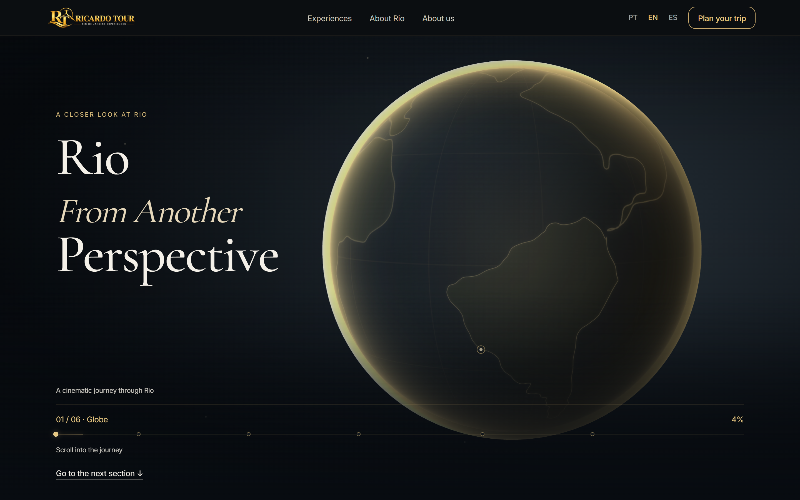
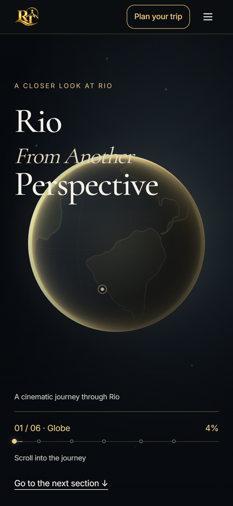
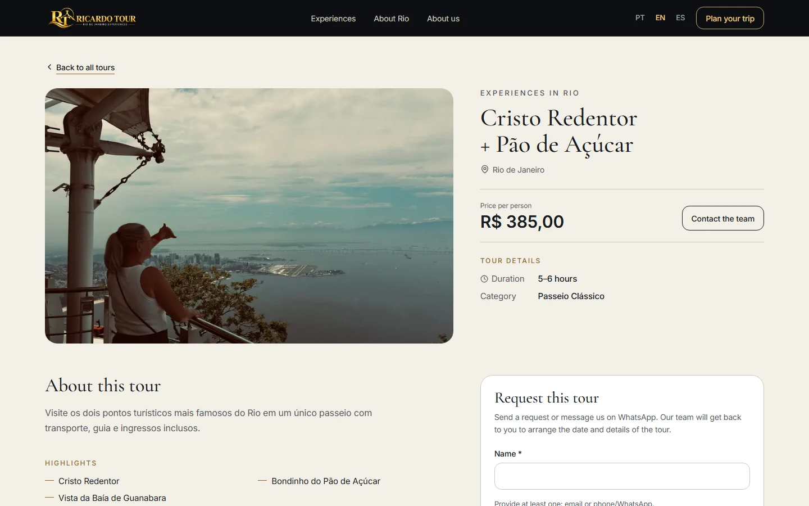

# Ricardo Tour

Ricardo Tour is a multilingual tourism platform built for a travel business in Rio de Janeiro, Brazil. Travelers can explore guided experiences, compare tour details, and send a request to the team.

## Project Overview

Ricardo Souza developed the application as a full-stack product for the business. It combines a localized storefront, server-side workflows for tour inquiries and reservations, and a protected administration area.

## Live Website

**[Visit ricardotour.com](https://www.ricardotour.com/en)** · [Tour catalog](https://www.ricardotour.com/en/tours) · [Português](https://www.ricardotour.com/pt) · [Español](https://www.ricardotour.com/es)

## Application Screenshots



*English homepage at 4% journey progress, desktop viewport 1440 × 900.*

| Mobile homepage | Tour details |
| :--: | :--: |
|  |  |
| English homepage at 4%, 390 × 844 | Production, 1440 × 900 |

## Business Context

Ricardo Tour offers guided experiences and personalized travel support in Rio de Janeiro. The website gives travelers a place to research itineraries and gives the team the information it needs to follow up in its day-to-day operations.

## Key Features

- **Public storefront** with a cinematic introduction to Rio, a tour catalog, and detail pages showing itineraries, inclusions, and pricing where published.
- **Tour inquiries** with a public request form and a WhatsApp contact option on the tour detail page.
- **Account and administration features** implemented in the repository, including sign-in, a customer reservations area, and protected tools for tours, bookings, and contact submissions.

## Technology Stack

| Area | Technology |
| --- | --- |
| Runtime and UI | Node.js 22, Next.js 16.2.4 (App Router), React 19.2.0 |
| Language and styling | TypeScript 5.9.3, Tailwind CSS 4.1.16 |
| Data | PostgreSQL, Prisma 7.8.0 |
| Authentication and localization | Better Auth 1.5.6, next-intl 4.9.1 |
| Quality and hosting | ESLint, Vitest 4.1.5, Playwright 1.59.1, Vercel |

Dependency versions reflect the npm lockfile for this repository.

## System Architecture

| Path | Responsibility |
| --- | --- |
| `app/[locale]/(site)/` | Localized storefront and tour catalog |
| `app/[locale]/(public)/reservas/` | Authenticated customer reservations |
| `app/[locale]/admin/` | Protected tools for tours, bookings, and contacts |
| `app/actions/` and `app/api/` | Server Actions and Route Handlers |
| `lib/services/`, `lib/auth.ts`, and `lib/authz.ts` | Business logic, sessions, and authorization |
| `prisma/` | PostgreSQL schema and migration history |
| `i18n/` and `messages/` | Locale routing and interface copy |

## Internationalization

The public interface supports Portuguese, English, and Spanish. Portuguese is the default locale. Localized routes and language metadata support navigation and discovery across the three versions. Tour descriptions depend on the translations available for each listing.

## Authentication & Security

Better Auth provides email and password sign-in and session management. Server-side guards enforce administrator access to protected operations. The server controls role assignment and validates redirect destinations within the site.

## Booking Management

1. A traveler opens a tour and submits a request or contacts the team on WhatsApp.
2. The public form records a tour inquiry. The team follows up to arrange dates and details.
3. In the separate account-based reservation workflow, customers can view their bookings. Authorized staff can review and confirm pending bookings or cancel eligible bookings.

## Getting Started

Use Node.js 22, npm, and a local PostgreSQL database. The repository includes a Docker Compose configuration for PostgreSQL.

```sh
npm ci
```

Copy [`.env.example`](.env.example) to `.env` and set `DATABASE_URL`, `BETTER_AUTH_SECRET`, and `BETTER_AUTH_URL` for your local environment. Use `http://localhost:3000` as the auth URL for the default development port.

With `DATABASE_URL` pointing to your local development database, apply the checked-in migrations and start the application.

```sh
npx prisma migrate deploy
npm run dev
```

Open `http://localhost:3000`. A fresh database needs tour data before the catalog can display tours.

## Testing & Quality

```sh
npm run lint
npm run typecheck
npm test
npm run build
```

Use `npx playwright install chromium` to install the browser for the public suite. Run `npm run test:e2e:public` against a running instance by setting `PLAYWRIGHT_BASE_URL`, for example `http://localhost:3000`. The suite checks public navigation and pages without submitting forms. Run `npm run test:e2e` for the broader suite with an isolated test database and configured test accounts.

## Deployment

| Environment | Purpose |
| --- | --- |
| Production | Official public site hosted on Vercel at [ricardotour.com](https://www.ricardotour.com/en). |
| Preview | Vercel review environment for branch changes. Availability depends on the branch and access permissions. |
| Local | Next.js development server and a developer-managed database. |

## Project Roadmap

| Status | Scope |
| --- | --- |
| Live | Multilingual public site, tour discovery, and tour inquiry entry points. |
| In development | Preparing the commercial catalog for the operator’s three own tours. |
| Planned | Publishing the updated catalog as tour content, translations, and operational readiness are approved. |

## Author

**Ricardo Souza** · Full-stack developer · [GitHub](https://github.com/devricardo90)
